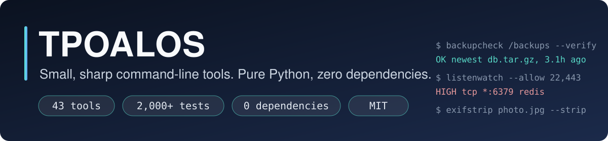

<div align="center">



</div>

I build **small command-line tools that solve one real problem each**, in pure Python with **no dependencies**: nothing to
install, nothing to audit, nothing that phones home. Every tool is a single repo with tests, a README, CI and an MIT licence,
and every one is **defensive or protective**: they check, warn and report. None of them attacks anything.

```bash
pip install git+https://github.com/TPOALOS/<tool>        # any tool below
```

**Browse everything in one place: [tpoalos.github.io](https://tpoalos.github.io)**

## Start here

| | Tool | What it does |
|---|---|---|
| 🛡️ | [**hostguard**](https://github.com/TPOALOS/hostguard) | Read-only hardening audit for Linux and macOS: 76 checks, a score, an HTML report and drift detection |
| 🔎 | [**portlens**](https://github.com/TPOALOS/portlens) | Defensive attack-surface scanner (nmap-style) with a scope guard and rate caps: it refuses to scan what you do not own |
| 📦 | [**pcaplens**](https://github.com/TPOALOS/pcaplens) | pcap/pcapng analyzer: TCP reassembly, scan, beacon and DNS-tunnel detectors, CTF stream tools |
| 🏁 | [**ctfhost**](https://github.com/TPOALOS/ctfhost) | Host your own CTF: scrypt logins, CSRF protection, dynamic scoring, first blood, a scoreboard |
| 💰 | [**pocketledger**](https://github.com/TPOALOS/pocketledger) | Private, local personal finance: bank CSV import, budgets, subscription detection, net worth, an HTML report |

## The small tools people actually use

### AI assistants and agents

| Tool | The question it answers |
|---|---|
| [**cmdguard**](https://github.com/TPOALOS/cmdguard) | Will this command my AI agent wants to run wreck my machine? (allow, ask or deny; works as a Claude Code hook) |
| [**mcpaudit**](https://github.com/TPOALOS/mcpaudit) | Is my MCP server configuration safe? (secrets, unpinned downloads, over-broad access) |
| [**injectscan**](https://github.com/TPOALOS/injectscan) | Is there a hidden instruction in this page or file? (invisible Unicode, hidden HTML, decoded for you) |
| [**ctxpack**](https://github.com/TPOALOS/ctxpack) | How do I give an AI my whole project without leaking my secrets? |
| [**tokcount**](https://github.com/TPOALOS/tokcount) | How many tokens is this, will it fit, and what will it cost? |

### Things that quietly break, until they cost you

| Tool | The question it answers |
|---|---|
| [**backupcheck**](https://github.com/TPOALOS/backupcheck) | Is my backup really there, fresh, not empty, and readable to the end? |
| [**jobwatch**](https://github.com/TPOALOS/jobwatch) | Did my cron job silently stop running? |
| [**diskwatch**](https://github.com/TPOALOS/diskwatch) | Will this disk fill up, and in how many days? |
| [**expirywatch**](https://github.com/TPOALOS/expirywatch) | What expires soon: passport, domain, certificate, insurance? |
| [**certwatch**](https://github.com/TPOALOS/certwatch) | When do my TLS certificates expire? |
| [**cronnext**](https://github.com/TPOALOS/cronnext) | What does this crontab really do, and when does it run next? |
| [**dupefind**](https://github.com/TPOALOS/dupefind) | Which files are duplicates, and how much space do they waste? |

### Privacy and leaks

| Tool | The question it answers |
|---|---|
| [**exifstrip**](https://github.com/TPOALOS/exifstrip) | What does this photo give away (GPS, camera, name), and can I remove it? |
| [**secretscan**](https://github.com/TPOALOS/secretscan) · [**githook-guard**](https://github.com/TPOALOS/githook-guard) | Did I just commit a secret? Block it before it leaves my machine |
| [**gitidentity-audit**](https://github.com/TPOALOS/gitidentity-audit) | Which of my commits expose a personal e-mail address? |
| [**logscrub**](https://github.com/TPOALOS/logscrub) | Redact secrets, e-mails and IPs from a log before I share it |
| [**shellhist-scrub**](https://github.com/TPOALOS/shellhist-scrub) | Which passwords did I type into my shell history? |
| [**envdrift**](https://github.com/TPOALOS/envdrift) | Does my `.env` match `.env.example`, and did I leave a placeholder secret? |
| [**pwlint**](https://github.com/TPOALOS/pwlint) | How weak is this password, really? (it is never printed or sent) |

### Security checks for your own systems

| Tool | The question it answers |
|---|---|
| [**listenwatch**](https://github.com/TPOALOS/listenwatch) | What is listening on this machine, and who can reach it? |
| [**sshcfg-audit**](https://github.com/TPOALOS/sshcfg-audit) · [**sshkey-audit**](https://github.com/TPOALOS/sshkey-audit) | Is my SSH server, client and key set-up safe? |
| [**authlog-summary**](https://github.com/TPOALOS/authlog-summary) | Who is hammering my SSH, and did one of them get in? |
| [**fimcheck**](https://github.com/TPOALOS/fimcheck) | Did any file change, or its permissions or owner? |
| [**permaudit**](https://github.com/TPOALOS/permaudit) | Which files are world-writable, SUID or have loose permissions? |
| [**headercheck**](https://github.com/TPOALOS/headercheck) | How good are my site's security headers? |
| [**jwtlint**](https://github.com/TPOALOS/jwtlint) | What is wrong with this JWT? |
| [**mailtriage**](https://github.com/TPOALOS/mailtriage) · [**urlcheck**](https://github.com/TPOALOS/urlcheck) | Is this e-mail or link a phishing attempt? (offline, never opened) |
| [**pathaudit**](https://github.com/TPOALOS/pathaudit) · [**symlinkcheck**](https://github.com/TPOALOS/symlinkcheck) · [**sudoers-audit**](https://github.com/TPOALOS/sudoers-audit) | Can someone hijack my PATH, my symlinks or my sudo rules? |

### Web servers, e-mail and untrusted files

| Tool | The question it answers |
|---|---|
| [**nginxcheck**](https://github.com/TPOALOS/nginxcheck) · [**cookiecheck**](https://github.com/TPOALOS/cookiecheck) | Is my nginx config or my Set-Cookie header weak? |
| [**mailauth-lint**](https://github.com/TPOALOS/mailauth-lint) · [**dmarc-report**](https://github.com/TPOALOS/dmarc-report) | Are my SPF, DKIM and DMARC records right, and who is failing them? |
| [**zipcheck**](https://github.com/TPOALOS/zipcheck) · [**csvguard**](https://github.com/TPOALOS/csvguard) · [**trojansrc**](https://github.com/TPOALOS/trojansrc) | Is this archive, spreadsheet or source file hostile? |

### Developer hygiene

| Tool | The question it answers |
|---|---|
| [**repolint**](https://github.com/TPOALOS/repolint) | Is this repository ready to share? |
| [**gha-audit**](https://github.com/TPOALOS/gha-audit) | Is my GitHub Actions workflow safe? |
| [**dockerfile-audit**](https://github.com/TPOALOS/dockerfile-audit) | Is my Dockerfile safe? |
| [**reqpin**](https://github.com/TPOALOS/reqpin) | Are my pip requirements pinned, hashed and free of typosquats? |

### Finance

| Tool | The question it answers |
|---|---|
| [**backtestlint**](https://github.com/TPOALOS/backtestlint) | Does my backtest peek into the future? (look-ahead and leakage lint) |
| [**riskmetrics**](https://github.com/TPOALOS/riskmetrics) | Is this Sharpe ratio real, or the luckiest of many tries? (deflated Sharpe, drawdowns) |

## How I build them

- **Zero dependencies.** Python's standard library only, so there is nothing to install and nothing to audit.
- **Read-only by default.** The tools report; when one can change something (`--strip`, `--scrub`, `--append`) it previews
  first, keeps a backup or writes a copy, and never deletes on its own.
- **Honest about limits.** These are checks, not oracles: a clean result means "nothing found", never "proven safe", and the tools say so.
- **Tested like it matters.** More than 2,000 tests across the repos, including hostile inputs (paths with `$(...)`, newlines in
  file names, symlinks that point outside the folder, truncated archives). The maintained tools run CI on Linux and macOS with actions pinned
  to commit SHAs.
- **Private by construction.** No network access, no telemetry, no accounts. Tools that must look at a network (`certwatch`,
  `headercheck`, `portlens`) only ever talk to hosts you name.

Issues and pull requests are welcome. If a tool saved you from a bad day, a star helps others find it.
